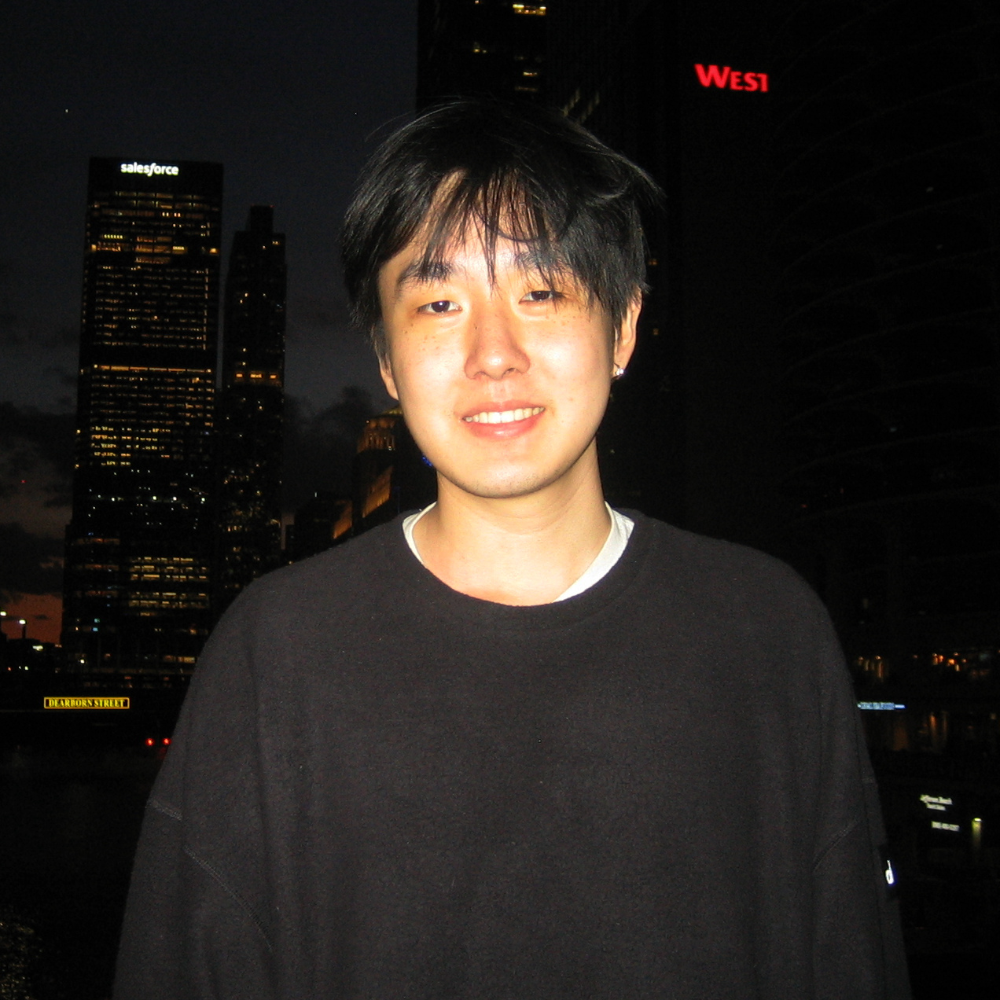
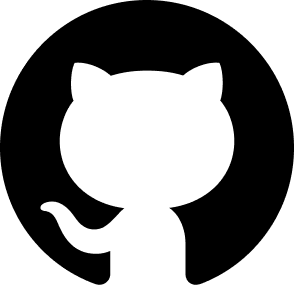
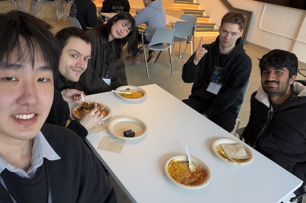

 

 

I'm currently a master's student in CS at [Brown University](https://cs.brown.edu/) working with Prof. [George Konidaris](https://cs.brown.edu/people/gdk/) and Prof. [Randall Balestriero](https://randallbalestriero.github.io/). Previously, I obtained my bachelor's in CS from [UCSB](https://www.cs.ucsb.edu/). There, I worked on zeroth-order optimization and tensor-compressed learning, advised by Prof. [Zheng Zhang](https://web.ece.ucsb.edu/~zhengzhang/).

Right now, I'm interested in *model-based reinforcement learning and state abstraction*. Currently researching ways to use learned models for decision-time policy improvement.

  <a href="mailto:richard_gao@brown.edu">Email</a> /
  <a href="https://scholar.google.com/citations?user=M11SUywAAAAJ&hl=en">Scholar</a> /
  <a href="https://www.linkedin.com/in/richard-gao-98490a1ba/">LinkedIn</a> /
  <a href="https://x.com/_rwgao">X</a> /
  <a href="https://github.com/rwgao1">GitHub</a>

<!-- 

  
  &nbsp;&nbsp;&nbsp;
  
  &nbsp;&nbsp;&nbsp;
  

 -->

## News

---

- <time datetime="2026-02">Feb. 2026</time> — Attended the [world modeling workshop](https://world-model-mila.github.io/) in Montreal.
    <!--    -->
- <time datetime="2025-09">Sep. 2025</time> — Started my master's at Brown.
- <time datetime="2024-12">Dec. 2024</time> — Graduated from UCSB.

## Publications

---

  
<strong>stable-worldmodel: A Platform for Reproducible World Modeling Research and Evaluation</strong>

  
<a href="https://lucasmaes.bearblog.dev/">Lucas Maes</a>, <a href="https://quentinll.github.io/">Quentin Le Lidec</a>, Luiz Facury, Nassim Massaudi, Ayush Chaurasia, Francesco Capuano, <strong>Richard Gao</strong>, Taj Gillin, <a href="https://danhrmti.github.io/">Dan Haramati</a>, Damien Scieur, <a href="https://yann.lecun.com/">Yann LeCun</a>, <a href="https://randallbalestriero.github.io/">Randall Balestriero</a>

  
<em>NeurIPS Evaluations and Datasets Track</em>, 2026

  
<a href="https://arxiv.org/abs/2605.21800" target="_blank" rel="noopener noreferrer">arXiv</a> / <a href="https://arxiv.org/pdf/2605.21800" target="_blank" rel="noopener noreferrer">pdf</a> / <a href="https://github.com/galilai-group/stable-worldmodel" target="_blank" rel="noopener noreferrer">code</a> / <a href="https://quentinll.github.io/data/swm2026.bib" target="_blank" rel="noopener noreferrer">bibtex</a>

## Misc.

---

Outside of research, I enjoy playing [piano](./Misc/Piano.md), tending to my [succulents](./Misc/Succulents.md), and basketball.

_Places others (and you!) have accessed my site from:_

